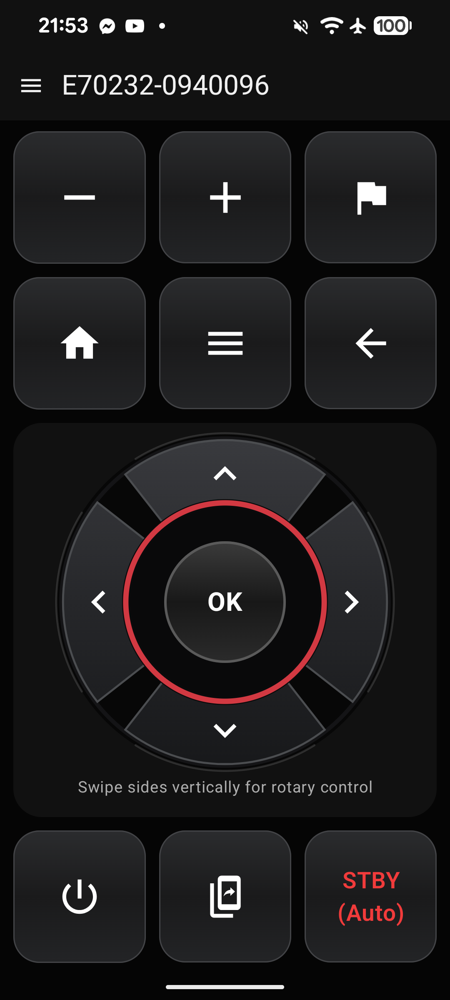

# SoftRMK

Unofficial Android remote-control app for compatible Raymarine multifunction displays.

  

## Disclaimer

This is an unofficial independent project.

- It is not made, endorsed, sponsored, approved, or supported by Raymarine.
- Raymarine, Axiom, RayNet, and other product names are trademarks of their respective owners.
- Use this project at your own risk. No warranty or guarantee is provided.

## Compatibility Note

For Raymarine a/c/e/eS/gS Series Wi-Fi-enabled MFDs, this app can connect either directly to the MFD's Wi-Fi network or through a Wi-Fi access point connected to the RayNet network.

For Axiom MFDs, this app requires a Wi-Fi access point connected to RayNet. Direct connection to the Axiom's built-in Wi-Fi is not supported because the control port is not exposed on the MFD Wi-Fi interface.

## What It Does

- Discovers compatible displays on the local network
- Pairs with a selected display and remembers it
- Sends key presses, held directional input, and rotary control input
- Uses a portrait-oriented control surface designed for phone use

## Project Status

This repository contains a native Android implementation written in Kotlin with Jetpack Compose.

The app is intended as a practical control client for supported devices and networks. Behavior may vary depending on display model, network topology, Android version, and device Wi-Fi restrictions.
